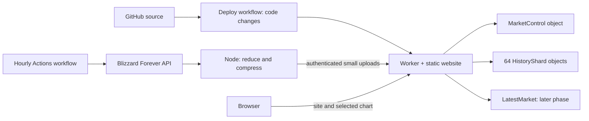

# Cloudflare Workers Free and Durable Objects: deployment proposal

Researched **2026-11-18**. The synthetic staging Worker, SQLite objects, chart, uploader and two manual GitHub workflows now have an implementation. Follow the staging runbook for executable commands. The live collector, production configuration and account-level acceptance measurements below are later milestones. [Staging runbook](../cloudflare/README.md)

The owner authorized a rolling 90 days of anonymous book history on November 19. The live implementation uses one SQLite object per UTC source day, encrypted hourly blocks, and an expiring key per source hour in Workers KV. The GitHub collector uses the shared hosted request budget. The deployment proposals below retain their original assumptions. [Live runbook](../cloudflare/live/README.md)

## Recommendation and boundaries

Use **Workers Free + SQLite-backed Durable Objects**, with the Node collector running in **GitHub Actions**. Host the browser assets with the Worker, keep API handling small, and store hourly history in 64 independently addressed objects. Code deployment and data collection are separate pipelines. No R2, D1, KV, Queues or Cloudflare Workflows service is needed initially.

Start with synthetic data in an isolated staging deployment, then connect historical charts in the existing localhost application. Expand to the fully hosted viewer after the live performance and retention checks below. The current local collector, setup UI and trading calculations remain available throughout this transition.

**Architecture review, 2026-11-18. Proceed with Free account setup and synthetic staging.** The largest measured shard uses 1.46% of the conservative per-object limit. Two full copies of the measured history would occupy about 1.71 GB across staging and production before additional services and staging versions. The first real-data increment can publish approved daily statistics from the local collector. Hosting hourly stock, current trading depth and an unattended collector depend on the data scope and restart behavior described below.

## What the products do

A Worker executes application code when a request arrives. A Durable Object combines a stable identity, application code and private persistent storage. Requests for the same named object reach that object's state; it can be recreated after eviction without losing its SQLite database. Class fields are disposable caches. A class/namespace can contain many instances, so 64 history objects do not require 64 classes. [Durable Objects concepts](https://developers.cloudflare.com/durable-objects/concepts/what-are-durable-objects/)

An object is not an S3-style downloadable file or a general database endpoint. Our code provides the read/write API. Splitting storage among objects also means there is no cross-object SQL join or transaction; publication needs an explicit manifest.

| Component | Proposed responsibility |
| --- | --- |
| Static website | Existing three data pages, new charts, filters and trade calculations in the browser |
| Ordinary Worker | Validate small request parameters/authentication; route requests and pass responses through |
| `HistoryShard`, 64 instances | Compressed daily blocks, selected-series decoding and history expiry |
| `MarketControl`, one instance | Collection lease, shared request reservations, source checks, dictionary/version state and committed generation |
| `LatestMarket`, one instance, later phase | Compressed current snapshot, including current neutral depth; gated by retention review |
| Node collector | Blizzard OAuth, fetching, catalog refresh, reduction, packing, compression and uploads |

## The 10 ms and 1 GB questions

The front Worker has **10 ms of CPU per request** on Free. Waiting for I/O is excluded. Durable Objects have a separately documented **30-second default invocation CPU allowance**. We will leave that default alone and test actual behavior on Workers Free. Its storage-full FAQ specifies **1 GB per Free object**, despite the general table listing 10 GB. Design against 1 GB. [Workers CPU limits](https://developers.cloudflare.com/workers/platform/limits/), [Durable Object limits](https://developers.cloudflare.com/durable-objects/platform/limits/)

Therefore the front Worker must never inflate the whole market, recompute trading tables, decode 90 days or assemble large JSON responses. It forwards a bounded upload stream or asks one object for a selected history series. The object decodes only a small group of observations and serializes the chart. The collector compresses incoming data outside Cloudflare.

Our [local measurement](durable-objects-storage-measurement.json) found:

| Quantity | Result |
| --- | ---: |
| Whole 90-day compressed database allocation | 855.8 MB |
| Largest compressed history object | 14.6 MB |
| Largest uncompressed history object | 41.3 MB |
| Largest compressed daily SQL row | 156 KB |
| One-series local Python history lookup | 75 ms compressed; 33 ms uncompressed |

The largest compressed object uses about **1.46% of a 1 GB limit**, so per-object storage is not close. The local 75 ms result is neither Worker CPU measurement nor Cloudflare latency. It describes work intended for the object, not the 10 ms front Worker. The documented row/BLOB ceiling is 8 MB. [SQL storage limits](https://developers.cloudflare.com/durable-objects/platform/limits/)

Memory deserves a real test: the limit is **128 MB per isolate**, and several objects can share it. We must not load all shard histories simultaneously. Decode one day/hour at a time, bound concurrent chart requests and use small caches. [Durable Object memory metrics](https://developers.cloudflare.com/durable-objects/observability/metrics-and-analytics/)

## Account quotas and operating budget

Free allowances are **5 GB stored/account**, **100,000 object requests/day**, **100,000 SQL writes/day**, **5 million SQL reads/day** and **13,000 GB-seconds/day** of active duration. Free overages fail operations rather than becoming paid usage; daily limits reset at midnight UTC. [Durable Objects pricing](https://developers.cloudflare.com/durable-objects/platform/pricing/)

The original storage experiment measured **1,600 history row changes/day** with in-place updates. The reviewed publication protocol below uses separate versions so readers can finish reading the last committed data. With one new version per shard and hour, budget **1,536 inserts + about 1,536 eventual deletes + 1,536 coordinator receipt updates = about 4,608 logical writes/day** in steady state. This assumes one compact receipt bitmap update per accepted shard, few concurrent versions and no retries. Measure additional writes for indexes, manifests, dictionary changes, budgets, alarms and failed runs against the proposed 10,000/day operating target. Measure the revised peak storage under load too. The local 856 MB result covers the original layout.

The front Worker has its own **100,000 dynamic requests/day** allowance. Cloudflare lists 50 subrequests per Free invocation and separately lists 1,000 for internal services. Choose one upload per shard for small bodies, bounded concurrency and independent retries. This costs 1,536 inbound uploads/day at full hourly cadence, plus control calls. Charge the internal receipt call and manifest lookup to the object request budget as well. [Worker limits](https://developers.cloudflare.com/workers/platform/limits/#subrequests)

For a personal-use example, 1,000 uncached favorite-chart requests/day imply roughly 90,000 daily history rows read, plus manifest, dictionary and index work. Each worst-shard cold query in the fixture also reads about 14 MB internally. At that traffic level, this amounts to about 14 GB/day of server-side reads and up to 2.16 million hourly frame decodes. Measure latency, CPU, active duration and memory with several clients opening the same popular item concurrently. Decode each frame once for all three houses.

Active duration is another budget: we do not keep 64 objects running continuously. They wake for ingestion, chart reads and sparse cleanup alarms, then become idle. At 0.125 GB/object, keeping all 64 active all day would consume roughly 691,200 GB-seconds/day, well beyond Free. Idle objects eligible for hibernation stop consuming duration. [Duration accounting](https://developers.cloudflare.com/durable-objects/reference/faq/)

Stay on **Workers Free**. The paid product's spending controls exclude stored-data and subscription charges, and do not guarantee a maximum invoice. Application limits below 4 GB are useful correctness checks; the free-plan provider limits provide the requested billing boundary. [Paid spending limits](https://developers.cloudflare.com/durable-objects/platform/spend-management/)

## End-to-end flow



### Pipeline 1: deploy application code

Proposed file: `.github/workflows/deploy-cloudflare.yml`.

Trigger on trusted default-branch code changes and manual dispatch. Restrict deployment and live collection environments to the trusted default branch, including manual runs. Pin Actions dependencies to reviewed commit SHAs. Use a standard Ubuntu runner with Node 24, `npm ci`, the existing `npm run check` and `npm test`, plus new hosted-adapter/runtime checks. Run a proposed `npm run build:hosted` to prepare `dist/` from an allowlist of browser assets and the four required `shared/` modules. Keep `.wow-local/`, `.dev.vars*`, `.wrangler/` and secrets outside version control and asset uploads.

Then run `npx wrangler deploy --config wrangler.jsonc` with deployment credentials supplied **only to that step**. Pull-request checks have no deployment or Blizzard secrets. Commit a tested exact Wrangler version and lockfile. Current Wrangler requires a supported Node release; this project's older Node 18 minimum is not a sufficient deployment-tool requirement. [Wrangler installation requirements](https://developers.cloudflare.com/workers/wrangler/install-and-update/)

A proposed production configuration is:

```jsonc
{
  "name": "gathering-ledger",
  "main": "cloudflare/worker.mjs",
  "compatibility_date": "2026-11-18",
  "workers_dev": true,
  "assets": {
    "directory": "./dist",
    "binding": "ASSETS",
    "run_worker_first": ["/api/*"]
  },
  "durable_objects": {
    "bindings": [
      { "name": "HISTORY", "class_name": "HistoryShard" },
      { "name": "CONTROL", "class_name": "MarketControl" }
    ]
  },
  "exports": {
    "HistoryShard": { "type": "durable-object", "storage": "sqlite" },
    "MarketControl": { "type": "durable-object", "storage": "sqlite" }
  }
}
```

The current documented `exports` declaration provisions SQLite-backed namespaces when deployed. Legacy `migrations` configurations remain supported, but must not be mixed with `exports`. This namespace declaration is distinct from our own SQL schema/data migrations inside each object. [Class export configuration](https://developers.cloudflare.com/durable-objects/reference/durable-objects-migrations/)

The staging package uses its own `cloudflare/wrangler.jsonc`, the name `gathering-ledger-staging`, and a `new_sqlite_classes` migration for both bindings. A future production deployment needs its own Worker name and namespaces. [Staging configuration](../cloudflare/wrangler.jsonc)

Static assets are free to serve and have no additional storage charge. Only `/api/*` invokes the script first; keep normal HTML, CSS and JavaScript on the asset path. Updating market data will not redeploy these assets. [Static asset billing](https://developers.cloudflare.com/workers/static-assets/billing-and-limitations/), [asset routing configuration](https://developers.cloudflare.com/workers/wrangler/configuration/)

### Pipeline 2: collect market data

The proposed `.github/workflows/collect-market.yml` uses the following triggers in its scheduled production version.

```yaml
on:
  schedule:
    - cron: '37 * * * *'
  workflow_dispatch:
permissions:
  contents: read
concurrency:
  group: market-collection
  cancel-in-progress: false
```

Begin with manual dispatch only. Add the schedule shown above after validating the first live hosted run. The job uses a standard runner, Node 24, `npm ci`, a ten-minute timeout, and a proposed `npm run collect:hosted`. Synthetic staging gets its own ingestion credential and generated fixtures. Only the live collector gets Blizzard credentials. Measure rounded runner usage before enabling hourly collection on a private repo. At three billed minutes per run, a 30-day month consumes about 2,160 runner minutes before deployments and retries. Check the owner's actual Actions allowance and blocking budget. [GitHub Actions billing](https://docs.github.com/en/billing/concepts/product-billing/github-actions)

Each run:

1. Acquires a time-limited collection lease with a monotonically increasing fencing number from `MarketControl`. Separately, adapt the existing `take()` and `defer(until)` interface to the coordinator. Immediately before each outbound attempt, atomically reserve one request at the coordinator's clock against the shared **600/rolling hour** and any lower upstream limit. Persist the longest Retry-After. An ambiguous reservation consumes capacity conservatively. Coordinate the localhost server and neutral inspection CLI before either can use the same app credentials concurrently with Actions. A failure to obtain a reservation stops the outbound request. [Current budget implementation](../src/request-budget.mjs)
2. Restores the matching catalog, validator pair, reduced quotes including neutral depth, and source ages for the last committed compatible generation, once an expiry-compatible store exists. On first boot, expiry, or unavailable checkpoint, use the collector's existing full-body cold path. Persist budget/cooldown state independently. A validator alone cannot reconstruct the previous quotes after a 304. For the first live stage, run this step locally where the existing state lives. [Market reuse conditions](../src/market.mjs)
3. Reuses the current Forever-only collector for **110, 113, 116**, including item and commodity documents. Normally six auction checks per run, about **144/day**, plus OAuth, daily catalog refresh, retries and mixed-response recovery. Count every attempt against the budget.
4. Preserves the existing conditional GET behavior: unchanged houses reuse reduced summaries; partially changed houses fetch missing bodies as needed for cross-feed deduplication and weighted medians. Distinguish source publication, last check and last changed collection times. A 304 does not invent a fresh market observation.
5. Reduces books in Node, discards raw bodies, assigns stable dictionary IDs and encodes/compresses one hourly frame per shard. Route by a versioned hash of the canonical item ID and variant key. Allocate each numeric ID once and never reuse it while referenced. The benchmark used the sorted row position, which can change when another item is added. Test reorder, missing and reappearing variants, and new catalog names. Encode UTC hour slots, coverage by market and source time explicitly. A late run uses its actual observation/check time. A skipped hour stays a gap. An unchanged-source slot can carry its original source time and value subject to expiry.
6. Uploads each bounded frame with the generation, UTC hour, shard index and checksum. The shard builds a **new version of that day's block from the previously committed version** and persists it under a generation-specific key, along with any dictionary additions. The shard reports its durable receipt to the coordinator. Replaying the same key and digest resends the receipt. A different digest for that key fails. Bound compressed bytes, decoded bytes, number of records and permitted slots on the server. Accept only the 64 named shard destinations.
7. Once all 64 receipts match the expected generation and digests, the coordinator atomically checks the current fence, lease expiry and base revision, records the exact version for the UTC day and switches the published manifest. Include the latest snapshot version when serving live tables. A duplicate commit returns its existing outcome. A superseded runner cannot advance the manifest. A chart pins the committed day versions for its requested interval and the matching dictionary, then reads those exact keys. Selecting every generation below a watermark could expose an abandoned upload. Keep old committed versions for the maximum in-flight read window and retry the whole read against a fresh manifest if a version has expired. Reclaim abandoned versions after their leases expire. [Per-object transaction scope](https://developers.cloudflare.com/durable-objects/api/sqlite-storage-api/)
8. Updates source-check status, releases the lease and writes a small operational summary without credentials or API bodies. Removes temporary runner files. Upload failures are retried with a bound; unavailable data stays visibly stale.

Hourly source samples cannot be backfilled from missed Actions jobs. GitHub documents schedule delays, dropped jobs during load and disabling public schedules after 60 inactive days. Starting at minute 37 avoids the top-of-hour rush; it is not a scheduling guarantee or a claim about Blizzard's next publication. [GitHub schedule behavior](https://docs.github.com/en/actions/reference/workflows-and-actions/events-that-trigger-workflows#schedule)

Standard public-repository runners are free; private-repository compute and artifact/cache storage have separate allowances. Preserve the owner's provider-side GitHub stop budgets and avoid data artifacts. No Cloudflare setting limits a GitHub bill. The source repository still needs to be created/connected; this checkout has no active GitHub workflow. [Actions billing](https://docs.github.com/en/billing/concepts/product-billing/github-actions)

### Maintenance and recovery

Expire completed days during ingestion and with sparse daily alarms, so cleanup is independent of collector success. Enforce the cutoff at read time as well. For a rolling 2,160-hour graph, the interval can touch 91 UTC dates. Retain the first partial day until its last visible hour expires, and trim both ends at query time. Count source age separately wherever the data has a shorter TTL. Alarms should be idempotent and reschedule themselves. Include their requests and writes in the operating budget. [Alarms API](https://developers.cloudflare.com/durable-objects/api/alarms/)

Keep readers compatible with the previous data format across deploys. For recovery, pause the writer and validate the candidate manifest against every referenced shard version, dictionary revision and checksum before publishing it. Restoring objects independently to nearby timestamps can combine inconsistent generations. Restore the last fully verifiable generation or display a gap. Exercise this with synthetic data and reapply expiry on restore.

Daily GitHub Release backups remain optional, not required for serving charts. If added, use only retention-approved app recovery data, checksums, bounded partitions and explicit expiry. Do not use public releases to distribute a generic dataset. Built-in recovery helps with mistakes but is not an independently controlled copy.

## Browser API and current-project changes

Proposed routes:

| Route | Use |
| --- | --- |
| `GET /api/status` | Committed generation, source ages, last check, next collection and small usage summary |
| `GET /api/history?item=3820&variant=...&days=90` | One variant, all three markets; bounded date range |
| `POST /api/ingest/begin` | Acquire a fenced collection lease and its base manifest revision |
| `POST /api/ingest/budget/take` and `/defer` | Authenticated per-attempt budget and upstream cooldown shared by collector clients |
| `POST /api/ingest/shards/0` through `/63` | Authenticated hourly uploads |
| `POST /api/ingest/commit` | Publish a complete generation |
| `GET /api/snapshot` | Later hosted-current-state phase, preserving existing response shape |

A chart routes to one shard, reads its daily blocks and emits only the requested series. Group the three markets in one response. The current-size three-market 90-day chart has about 78 KB of price/quantity numbers before timestamps/status and encoding. This avoids visitors downloading the database. The server reads larger blocks, roughly 14 MB for a cold 90-day query in the local fixture.

Use browser caching, conditional responses and completed-day cache keys. Do not count an edge-cache hit as a guaranteed free Worker request or rely on cache persistence for correctness. The Cache API is data-center-local; deployment-domain behavior must be verified before depending on it. [Cache behavior](https://developers.cloudflare.com/workers/runtime-apis/cache/)

The localhost UI currently requests status every two seconds. At that cadence one continuously visible tab can generate **43,200 requests/day**, and three can generate **129,600**. For hosted reads, check on open, on explicit refresh and at most once every five minutes while visible (288 timer requests/day/tab). Coalesce focus and timer checks, pause background polling, and back off on errors. Fetch the snapshot only when its committed version changes. For the early localhost chart client, proxy a fixed read-only chart route through the local server so the browser can use its own origin. [Current UI polling](../public/app.mjs)

Extract the collector orchestration from `src/server.mjs` into a reusable CLI; retain `src/blizzard.mjs`, `src/catalog.mjs` and `src/market.mjs` semantics. Add adapters for shared budgets and uploaded state. `public/app.mjs` needs a hosted data adapter, sparse status refresh and history charts. Continue running `shared/trade.mjs` and `shared/resale.mjs` in the browser.

The hosted UI does not accept or expose Blizzard credentials. Public Refresh reloads published state; owner-only Collect now can initially be a manual workflow dispatch. The existing localhost setup remains for local use. A hosted equivalent must not expose the localhost mutation endpoints or its local CSRF assumptions to anonymous visitors.

The current Neutral → Alliance calculation needs **current anonymous price-level depth**, not just historical minimums. Preserve that in the later latest-snapshot path. Otherwise hosting only summary prices would silently break expected-profit drill-downs. Item names/categories and optional liquidity-provider data also need explicit adapters/expiry handling, not an assumption that the existing localhost routes will work remotely.

The latest saved snapshot measured about **44 MB JSON / 1.63 MB gzip**. Have Node encode it, store bounded chunks under the generation's manifest and stream the encoded response with the corresponding HTTP headers and ETag. A regression check should compare hosted expected profit and its per-price quantities/fees against the same local snapshot. [Snapshot measurements](history-storage-spike.md)

## Retention is a separate deployment gate

The [recorded decision](blizzard-api-terms.md#owner-retention-decision-2026-11-16) initially permits longer-lived daily processed price min/max/mean. Full 90-day hourly price/stock is the capacity target, not an already changed retention policy. Record the final hourly/stock decision before enabling that production archive.

SQLite Durable Objects support recovery to any point in the past **30 days**, across SQL and key-value contents. Deleting a live row does not by itself demonstrate that earlier copies are unrecoverable. [Recovery API](https://developers.cloudflare.com/durable-objects/api/sqlite-storage-api/)

Consequently raw books stay out of Durable Objects, logs and workflow artifacts. The initial cloud pilot stores synthetic data, followed only by approved processed statistics. Keep the current detailed snapshot/catalog local until we verify whether recovery retention can meet the project's 30-day rule for every other API-derived field. Do not assert that daily replacement or SQL DELETE solves this. This affects the hosted-current-state phase, not the synthetic runtime pilot or its capacity conclusion.

**First live path.** Use one producer on the owner's machine with its existing cache, validators and shared local budget. Compute each UTC day's approved min/max/mean there, then upload only the daily summaries and necessary identifiers for the charts. The proposed daily graph measures the minimum unit ask in each distinct observed market publication. Its daily low, high and arithmetic mean give each priced publication equal weight. Ignore missing and bid-only prices and show sample coverage. Label these as statistics of observed **minimum asks**. Statistics across every listed ask would require separate accumulators before order-book reduction. Cloud history can grow even while detailed current prices stay local. A machine that sleeps will leave gaps. The synthetic staging workflow can exercise the eventual hourly format in parallel.

For any field outside the long-retention decision, enforce expiry from its oldest contributing source across backups, temporary files and logs. For example, replacing a row when its source is 29 days old can leave that row restorable for nearly another 30 days. The local store also currently performs file expiry on read. Add independent expiry for retained working files, or process those inputs in memory and discard them, before relying on unattended cleanup. Promote the hosted collector after choosing a compatible checkpoint policy or deliberately using the full-body cold path. Keep local collection on the same hosted budget if both producers can run. [Local expiry implementation](../src/store.mjs)

## Account access and initial rollout

1. Create a Cloudflare account and leave Workers on **Free**. Choose a `workers.dev` subdomain. A purchased domain or DNS migration is unnecessary for the pilot. Automated ingest requests should use a descriptive User-Agent because workers.dev has platform-managed request checks. [workers.dev configuration](https://developers.cloudflare.com/workers/configuration/routing/workers-dev/)
2. For interactive setup, `npx wrangler login` opens Cloudflare authorization in the owner's browser. For CI use account ID plus an API token stored as a GitHub secret. No Cloudflare password or global API key is needed. [Deployment authentication](https://developers.cloudflare.com/workers/ci-cd/external-cicd/github-actions/)
3. For a granular API token, initial Worker creation needs **Workers product Admin**; routine deployments can use **Editor scoped to the existing Worker**. Bootstrap with temporary access, then restrict it. Durable Object administrative access follows the implementing Worker's permissions; there is not a separate bucket credential. [Workers permissions](https://developers.cloudflare.com/workers/authorization/workers/), [Durable Object permissions](https://developers.cloudflare.com/workers/authorization/durable-objects/)
4. Keep `CLOUDFLARE_API_TOKEN` only for deployment. Generate a separate random `MARKET_INGEST_TOKEN`, stored as a Worker secret and collector secret. Give the collector Blizzard client ID/secret through GitHub secrets. Set the nonsecret account ID and service URL as variables. Use local secret input or secret stores rather than pasting credentials into chat, repository files or workflow inputs. [Worker secrets](https://developers.cloudflare.com/workers/configuration/secrets/)
5. Test locally and dry-run the staging bundle. In staging, seed 90 completed synthetic days as 64 × 90 = 5,760 daily blocks with shard/day-varying contents and sizes. Restrict the fixture loader to staging. Exercise the normal hourly protocol over that seed, including missing hours and dictionary growth. A full seed verifies capacity without spending 138,240 hourly shard uploads from one day's request quota.
6. After staging, the local producer can publish approved daily aggregates to a dedicated daily series. Specify the daily cadence and statistic in both the endpoint response and the chart. The eventual hosted hourly collector starts with one manual run after the hourly data scope, checkpoint and shared budget are ready. Compare source ages, charts and neutral trade math with localhost, exercise retry and restart, then enable the schedule.

The implemented staging package has its own lockfile, config and public asset directory. Its sole deploy target is `gathering-ledger-staging`. The runbook covers local testing, owner authorization, staging deployment and optional CI. Production deployment depends on a separate configuration and the acceptance checks below. [Staging runbook](../cloudflare/README.md)

Proposed CI names:

| Name | Location | Purpose |
| --- | --- | --- |
| `CLOUDFLARE_API_TOKEN` | Deploy environment secret only | Update Worker code/configuration |
| `CLOUDFLARE_ACCOUNT_ID` | Deploy variable | Select account |
| `MARKET_API_URL` | Collector variable | Select staging or production endpoint |
| `MARKET_INGEST_TOKEN` | Worker secret + collector secret | Authenticate data writes, no cloud account administration |
| `BLIZZARD_CLIENT_ID`, `BLIZZARD_CLIENT_SECRET` | Collector secrets | Existing client-credentials grant |

## Acceptance evidence before production

Targets below are our proposed acceptance criteria, not Cloudflare guarantees:

- Front Worker p99 CPU below **5 ms**, with no 10 ms resource errors, including authentication and uploads.
- Compare returned 90-day, three-market points against a golden fixture including a 91st partial UTC date, a partial feed failure, repeated publication, empty house, bid-only series and genuinely fractional unit asks. Target cold chart processing below **one second** initially and peak isolate memory below **64 MB** with concurrent reads. Record client wall time separately from front Worker CPU and object duration.
- Actual account storage below **4 GB**, bounded growth after expiry and measured object/row sizes. Account for hidden platform metadata and staging storage; the local SQLite benchmark does not measure those.
- Measured ingestion, metadata, maintenance and retry usage below **10,000 SQL writes/day**. Observe SQL cursor `rowsRead`/`rowsWritten`, `databaseSize` and account analytics rather than translating local SQLite changes directly into a bill. [SQL instrumentation](https://developers.cloudflare.com/durable-objects/api/sqlite-storage-api/), [Workers runtime metrics](https://developers.cloudflare.com/workers/observability/metrics-and-analytics/)
- Kill the collector after shard 63 of 64, after a shard write but before its receipt, and after commit but before the HTTP response. Start a new lease, replay the old request and query charts throughout. Readers must see exactly one committed version of each day, including at midnight and during cleanup. Repeat with a changing synthetic market, new variants and gaps. The size fixture used the same snapshot in every hour.
- Shared Blizzard budgeting and Retry-After survive a fresh runner and overlap with a local diagnostic. No browser request triggers collection.
- Restore a synthetic checkpoint after an expiry boundary. Readers must enforce expiry before viewing a restored generation. Count stored bytes across staging, production and orphan versions. Verify response to a simulated quota error when the Worker returns a platform-level error page and no JSON, and preserve the last permissible view with an accurate age.

If a CPU or memory target fails, first narrow server reads or prepare selected chart projections during Node collection, then repeat measurements. Moving decoding into the front Worker or silently enabling a paid plan would not satisfy this proposal.
