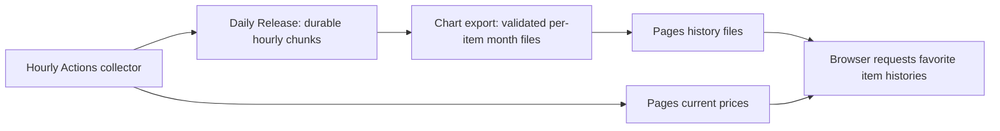

# GitHub Releases, selective chart delivery and hard spending controls

Researched **2026-11-18**. This updates the [hosting comparison](history-hosting-spike.md) for the owner's requirement: **a malfunction should stop service rather than incur unbounded usage charges**. Research only; no accounts, billing settings, workflows, releases or deployments were changed.

**Follow-up:** [Durable Objects Free](durable-objects-storage-spike.md) is now a strong alternative: a measured 0.856 GB grouped database, low modeled row writes and free-plan quota failures address the capacity and billing concerns. It can serve individual charts directly. The Releases/Pages design below remains an alternative and Releases could still provide recovery archives; no provider has been selected.

## Recommendation

**Use GitHub Releases as the recoverable daily archive and GitHub Pages as the small-file chart endpoint.** Visitors fetch history only for selected items, with a bounded optional browser cache. They do not download or retain the whole archive.

**R2 does not currently satisfy the requested provider-enforced free-tier cutoff.** This changes the earlier R2 recommendation. Its expected normal cost is low, but expected cost is a different requirement from preventing overage billing if code misbehaves.

## R2: limits versus alerts

Cloudflare introduced spending controls on November 13, but its current documentation limits them to **Workers and Durable Objects** and explicitly excludes **R2** from a Workers limit. It also says enforcement can lag and those controls do not guarantee a maximum invoice. [Cloudflare spending controls](https://developers.cloudflare.com/billing/manage/spend-management/)

Account-wide budget alerts send email and **do not pause or limit usage**. R2's free allowance is not a hard stop: usage above its included storage/read/write amounts is metered. I found no documented self-service setting to stop R2 at 10 GB-month, one million write-class calls or ten million read-class calls. Its published bucket data-storage and object-count limits are unlimited, not configurable free-tier ceilings. [Budget alerts](https://developers.cloudflare.com/billing/manage/budget-alerts/), [R2 pricing](https://developers.cloudflare.com/r2/pricing/), [R2 resource limits](https://developers.cloudflare.com/r2/platform/limits/)

Application counters, object-size checks and a rate-limited proxy would reduce risk but would not establish the provider-side spending guarantee requested here. A Worker limit does not cap R2 storage already present, other clients' calls, or every possible R2 operation initiated inside a request. I would not substitute those controls or email alerts for the owner's hard-budget requirement.

## Daily Releases are a useful archive

A Release can contain multiple separately downloadable assets. GitHub documents **up to 1,000 assets per release**, **under 2 GiB per file**, and no total release-size or bandwidth quota on that page. This is separate from Pages' site-size limit and ordinary expiring Actions artifacts. [Release quotas](https://docs.github.com/en/repositories/releasing-projects-on-github/about-releases)

For the measured summary format, the day's hourly observations total about **6.1 MB compressed**. A day could have:

```text
market-2026-11-18
  manifest.json
  hour-00-<generation>.bin.gz
  hour-01-<generation>.bin.gz
  ...
  day-summary-<generation>.bin.gz
```

Store each completed hour durably rather than waiting until midnight: Actions runners are temporary, and a daily-only flush could lose the day's observations. Verify the final daily compacted asset before pruning superseded hourly files. Serialize writers; use generation identifiers, checksums and source timestamps for retry/recovery. Release assets reject duplicate names rather than atomically replacing their content. [Release asset API](https://docs.github.com/en/rest/releases/assets)

Do not attach one asset per item to a single daily Release: approximately 20,800 base IDs would exceed its 1,000-asset limit. One daily archive, hourly chunks, or a modest number of ID-hash buckets fits. Release immutability settings affect whether files can be added/removed after publication, so the chosen draft/publication/expiry lifecycle needs a deliberate implementation. [Release immutability](https://docs.github.com/en/code-security/concepts/supply-chain-security/immutable-releases)

These Release archives are for the collector/recovery path. They need not be the browser's data endpoint.

## Direct Release downloads have a browser obstacle

I made credential-free HTTP requests with `Origin: https://example.github.io` against GitHub's own CLI release **v2.105.0**, asset **gh_2.105.0_checksums.txt** (1,971 bytes), plus control files:

| Path | Observed behavior | Implication |
| --- | --- | --- |
| `github.com/cli/cli/releases/download/...` | 302 to `release-assets.githubusercontent.com`; no `Access-Control-Allow-Origin` on either response | Does not authorize a cross-origin JavaScript read |
| REST asset URL with `Accept: application/octet-stream` | Initial 302 permits `*`; final binary response does not | REST redirect is not a dependable workaround |
| REST asset URL requesting JSON metadata | 200, allows `*` | Metadata is readable; it does not contain the asset bytes |
| Raw GitHub README | 200, allows `*` | Control permits a cross-origin read |
| Existing successful Pages URL | 200, allows `*` | Control permits a cross-origin read; same-origin Pages files avoid this issue entirely |

An ordinary download link can work even when a chart's `fetch()` cannot read the same response. CORS permission applies to script reads, not simply whether a URL can be opened or downloaded. `mode: "no-cors"` produces an opaque response and does not give the chart usable bytes. [Browser CORS rules](https://developer.mozilla.org/en-US/docs/Web/HTTP/Guides/CORS), [GitHub asset download behavior](https://docs.github.com/en/rest/releases/assets)

**Evidence boundary:** Node HTTP clients do not enforce browser CORS. These are live response-header observations plus the browser security rules, not a completed hosted browser test or a claim that every Release asset behaves identically. Attempting an isolated installed Chrome launch failed with a WSL interop socket error. Before choosing direct Release-to-chart fetching, test a controlled representative asset from the actual viewer origin. Do not make that unproven path a dependency when Pages offers a straightforward delivery path.

Avoid visitor-side REST discovery for every day/item. Unauthenticated GitHub REST usage is **60 requests/hour per IP**, shared by people behind that IP; querying 90 daily releases separately would already exceed that allowance. The collector can publish a static manifest, and browsers can use its direct chart-file URLs without REST discovery. [GitHub API limits](https://docs.github.com/en/rest/using-the-rest-api/rate-limits-for-the-rest-api)

## Visitors need kilobytes, not the whole archive

Example static chart layout:

```text
history/manifest.json
history/items/2770/<variant-key>/2026-11.bin.gz
history/items/2447/<variant-key>/2026-11.bin.gz
```

The chart downloads the requested item/variant's month files and date range. Favorites can be remembered by ID; an optional small LRU browser cache avoids repeat downloads. Archive size is independent of a visitor's selected-item download size.

For one variant with minimum price (8 bytes) and listed stock (4 bytes):

| Selected history, all three houses | Numeric values before compression |
| --- | ---: |
| 7 days, one item variant | 6,048 bytes |
| 30 days, one item variant | 25,920 bytes |
| 90 days, one item variant | **77,760 bytes** |
| 90 days, five favorite variants | **388,800 bytes** |

These are format calculations, not measured HTTP payloads. Add timestamps, validity/coverage flags, headers and any JSON overhead; compression can reduce the result. Equipment variants multiply the number of series if a user requests all variants of an item. The earlier **0.55–0.65 GB** projection describes all retained summary data, not a visitor's initial download, and its exact compression ratio has not been remeasured after per-item partitioning.

Keep buyout stock labeled as listed supply, not completed sales. Price/stock summaries cannot reproduce historical depth; full-book recovery archives, if retained, remain a separate content choice.

## A GitHub-only arrangement that fits together



Two publishing choices:

- **One Pages site:** simplest setup, but every hourly update assembles the complete site including history. Small visitor downloads do not remove collector/deployment transfer costs.
- **Separate current-app and history Pages projects:** publish the small current view hourly; rebuild the larger historical chart export daily. The browser combines completed-day history with a small current-day file. This avoids republishing the full historical bundle every hour, at the cost of a second repository/site and coordinated manifests. Each site stays within its own normal limits; this is separation by update cadence, not a proposal to shard a huge dataset across sites to bypass quotas.

At today's measured size, the compressed summary export fits Pages' **1 GB** site ceiling. Full order-book archives do not belong in that serving bundle. Per-item packing, file count and publication duration need an actual pilot; preserve headroom rather than assume aggregate compression predicts every export layout. Pages also has a **100 GB/month soft bandwidth limit**. [Pages limits](https://docs.github.com/en/pages/getting-started-with-github-pages/github-pages-limits)

## Other GitHub products

| Product | Fit for this project |
| --- | --- |
| **Releases** | Best GitHub-native durable archive candidate; group the day's data, use the runner to recover it, and serve chart views separately |
| **Pages** | Best direct browser endpoint for small public chart files; bounded published-site size rather than an R2-style object-store bill |
| **Git LFS** | A genuine hard-budget alternative: documented **$0 budget blocks overages**; Free includes **10 GiB storage and 10 GiB monthly bandwidth**. But every new file version counts in storage and runner downloads count in bandwidth, so repeatedly restoring/replacing a full window is a poor layout. Browser media delivery/CORS remains untested here |
| **Actions artifacts** | Suitable for transfer/build outputs; expiration and signed-in/read-access requirements make them a poor public chart endpoint or sole archive |
| **Actions cache** | Acceleration only; it can be evicted and cannot be authoritative for irrecoverable observations |
| **Packages / GHCR** | Public package/container distribution can be free; registry protocols and authentication rules are less natural for charts. Public OCI access has an anonymous exception, but that does not make the registry a ready-to-use static JSON endpoint |
| **Repository files / raw files** | Raw HTTP control worked, but observations accumulate Git history and deletion does not erase old versions. Do not use ordinary commits for rolling observation retention |
| **Gists** | Versioned code-snippet storage, with API truncation and file/list limits; no advantage over Pages/Releases for this archive |

Sources: [LFS billing and $0 stop](https://docs.github.com/en/billing/concepts/product-billing/git-lfs), [artifact access](https://docs.github.com/en/actions/how-tos/manage-workflow-runs/download-workflow-artifacts), [cache policy](https://docs.github.com/en/actions/reference/workflows-and-actions/dependency-caching), [Packages](https://docs.github.com/en/packages/learn-github-packages/introduction-to-github-packages), [public OCI](https://docs.github.com/en/packages/working-with-a-github-packages-registry/working-with-the-container-registry), [large-file guidance](https://docs.github.com/en/repositories/working-with-files/managing-large-files/about-large-files-on-github), [Gist limits](https://docs.github.com/en/rest/gists/gists).

## Hard cost controls on the GitHub path

GitHub supports budgets with **Stop usage when budget limit is reached**, rather than email-only alerts, for metered products. Configure the applicable Actions/storage/cache budget controls to disallow overages **before enabling collection**, and leave paid cache expansion/larger runners disabled. Public standard-runner compute is free, but do not infer that every retained build artifact is free. LFS, if used, has its own explicit $0 behavior. [Budget setup](https://docs.github.com/en/billing/how-tos/set-up-budgets), [included usage](https://docs.github.com/en/billing/reference/product-usage-included), [Actions billing](https://docs.github.com/en/billing/concepts/product-billing/github-actions)

The preferred failure is a blocked upload or stale site, with all durable collected history recoverable. Retain build artifacts briefly and verify cleanup/accounting: a daily Pages archive around 0.55 GB is already near/above the Free plan's 500 MB Actions-storage allowance, depending on the archive representation and account usage. A pilot must prove both publication and $0-budget behavior; a stop budget is not evidence that all desired jobs will remain available. GitHub also notes that a newly created budget excludes earlier usage in its first cycle. [Budget behavior](https://docs.github.com/en/billing/concepts/budgets-and-alerts)

Separately, bound the collector's loop counts, file sizes and total export bytes so ordinary failures are caught before publication. Those are application correctness controls, not the billing protection; the provider-side block is what addresses the owner's concern about application bugs. Keep no write-capable credential in the visitor's page. No account settings were inspected or changed in this research.

## Optional alternative without R2

If another provider is acceptable but metered R2 is not, **Cloudflare Pages static hosting** is a different product worth considering. Its static-asset requests are documented as free and unlimited, with Free-plan file/asset/build limits. It is not an object-storage free tier that automatically meters additional reads. Avoid Functions/paid bindings for that static-only design. Current Free limits include 20,000 files, 25 MiB per asset and 500 builds/month, so group item files into buckets or partitions and use a suitable publication cadence rather than assuming unlimited builds or one file per point. [Static asset pricing](https://developers.cloudflare.com/pages/functions/pricing/), [Pages limits](https://developers.cloudflare.com/pages/platform/limits/)

## Decision implication

For the stated hard-overage constraint, my updated first choice to prototype is **Releases for recovery + per-item Pages charts**, with provider-side stop budgets and a representative deployment/browser check. R2 remains technically convenient but does not meet the requested billing guarantee. LFS is a secondary GitHub option with a documented zero-overage setting, not the default browser serving layer.

This is a direction for review, not a provider selection or a deployed system. The [raw-data 30-day TTL and processed-statistics decision](blizzard-api-terms.md#owner-retention-decision-2026-11-16) still govern Release assets, artifacts, Pages files, caches and backups. Hourly collection remains best-effort under GitHub schedules; data loss and delayed publication must remain visible.
